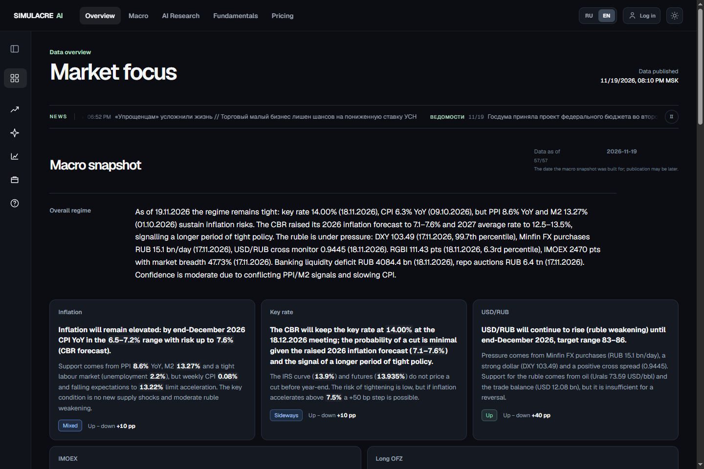
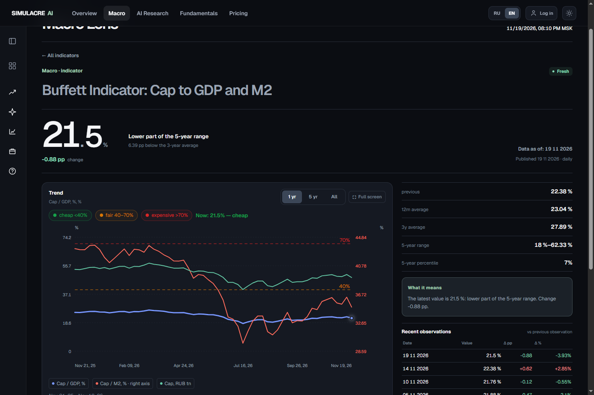
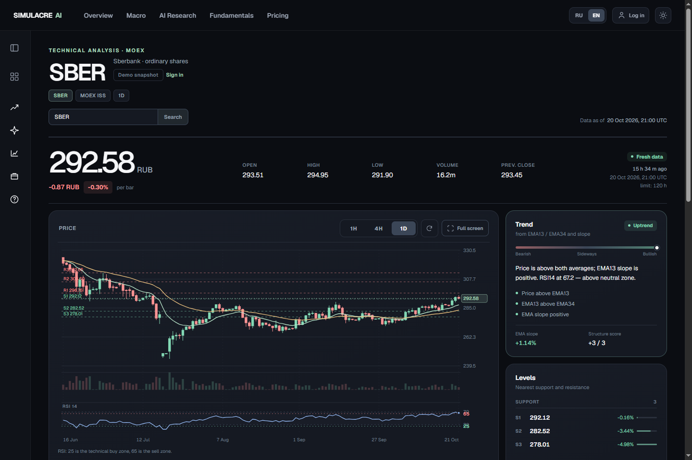
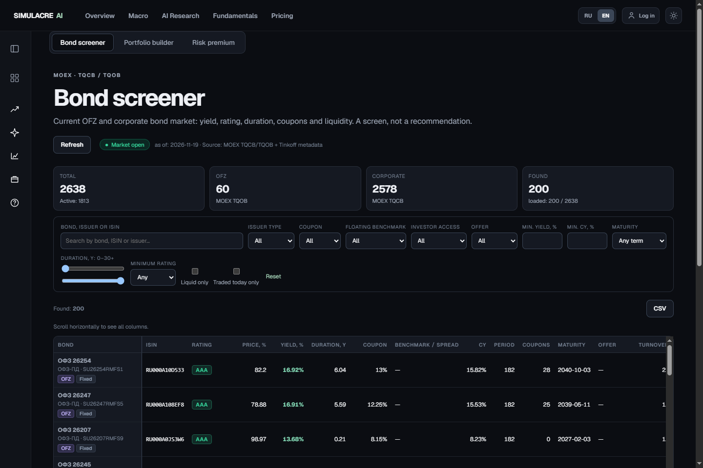

# Tuskul Kaigorodov

**Financial analytics · Risk & portfolio research · AI tools**

My background spans banking risk, portfolio management and ALM analytics. I build models, data workflows and applications that turn financial questions into usable analytical tools.

[Simulacre AI](https://simulacre-ai.ru/site/) · [LinkedIn](https://www.linkedin.com/in/kaigorodov-ts/) · [LeetCode](https://leetcode.com/u/kaygorodov_ts/) · [Telegram](https://t.me/kaigorodov_ts)

## Simulacre AI

My main project: a financial analytics platform for the Russian market, combining macroeconomic data, market analysis, company fundamentals and AI-assisted research.

| Area | What the platform brings together |
| --- | --- |
| **Macroeconomics** | Historical indicators, interactive charts, interpretation, statistics and exports. |
| **Markets & valuation** | Technical analysis on 1H / 4H / 1D, company screening, financial metrics and valuation scenarios. |
| **Research & integration** | AI-assisted investigations, source-backed reports and MCP access for AI assistants. |
| **Delivery** | A shared data and service layer for the website, Telegram bot and Mini App, with scheduled publishing and cached chart rendering. |

[Explore the platform](https://simulacre-ai.ru/site/) · [Connect via MCP](https://simulacre-ai.ru/site/mcp/) · [Telegram companion](https://t.me/simulacre_ai_bot)

<table>
  <tr>
    <td width="50%" valign="top">
       
      <strong>Market overview</strong> · data and macroeconomic context
    </td>
    <td width="50%" valign="top">
       
      <strong>Macro indicators</strong> · charts, history and interpretation
    </td>
  </tr>
  <tr>
    <td width="50%" valign="top">
       
      <strong>Technical analysis</strong> · price structure and indicators
    </td>
    <td width="50%" valign="top">
       
      <strong>Company valuation</strong> · assumptions, scenarios and value drivers
    </td>
  </tr>
</table>

Click any screenshot to open the full-size image. Analysis shows the labelled public demo snapshot.

## Selected open-source projects

| Project | Focus |
| --- | --- |
| [Veil](https://github.com/KaigorodovTuskul/veil) | Local document masking and a privacy proxy for AI workflows. |
| [EasyRAG](https://github.com/KaigorodovTuskul/easyrag) | DOCX retrieval with exact search, BM25, hybrid retrieval and a chat UI. |
| [Portfolio Models](https://github.com/KaigorodovTuskul/portfolio-models-agent-skill) | Reference portfolio optimizers, risk models and reproducible evaluation workflows for AI agents. |
| [CBR Liquidity Intelligence](https://github.com/KaigorodovTuskul/cbr-liquidity-intelligence) | Bank of Russia reporting, banking liquidity and money-market research. |
| [Editorial Design](https://github.com/KaigorodovTuskul/editorial-design-agent-skill) | An agent skill and rendering engine for financial publications, PDF and editable PPTX. |
| [Simulacre Financial Charts](https://github.com/KaigorodovTuskul/simulacre-financial-charts-skill) | Financial and macroeconomic visualization with reproducible chart decisions. |

More finance-focused tools: [Funds transfer pricing](https://github.com/KaigorodovTuskul/codex-skill-bank-funds-transfer-pricing) · [MOEX ISS API](https://github.com/KaigorodovTuskul/codex-skill-moex-iss-api) · [Market Analysis Atlas](https://github.com/KaigorodovTuskul/Market-Analysis-Atlas-Financial-Intelligence-Skill) · [Pattern Atlas](https://github.com/KaigorodovTuskul/Pattern-Atlas-Technical-Analysis-Agent-Skill).

## Working stack

| Work | Tools and methods |
| --- | --- |
| **Financial modelling & forecasting** | Python, pandas, NumPy, scikit-learn, CatBoost, Prophet, statsmodels; time series, rate scenarios, liquidity and portfolio risk. |
| **Data & analytical applications** | SQL, Oracle, PostgreSQL, SQLite, Streamlit, Apache Superset. |
| **Platform development** | FastAPI, Pydantic, TypeScript, React, Astro, aiogram. |
| **AI & documents** | MCP, RAG, hybrid retrieval, agent tools, local and hosted model APIs. |
| **Delivery & validation** | Docker, Caddy, uv, GitHub Actions, pytest, Playwright / Chromium. |

## Hackathons · Triggers team

| Event | Built |
| --- | --- |
| [AI for Finance Hack](https://changellenge.com/championships/aiforfinancehack) · Oct 2025 | Financial-document RAG chatbot. |
| [HACK-the-ICE 7.0](https://www.xn--80aa3anexr8c.xn--p1acf/tpost/os3klanpe1-hack-the-ice-70) · Nov 2025 | Opora, a social-benefits application. |
| [AI DevTools Hack · Cloud.ru](https://changellenge.com/championships/ai-devtools-hack/) · Dec 2025 | MOEX data tools for AI agents through MCP. |
| [Master of Telegram Ads](https://hackathon.clickise.org/) · Jan 2026 | AI-assisted ad generation. |

## GitHub stats

## Algorithms & SQL practice

